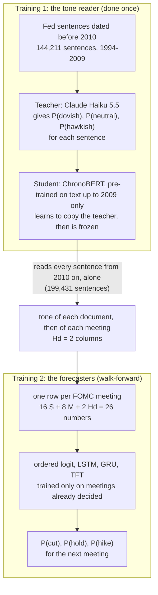

# Does the Fed's own tone help forecast its rate decisions?

Before every FOMC meeting, this project forecasts one thing: **will the Fed cut, hold or hike?** It then asks a second
question: does reading the **tone of what the Fed itself said and wrote** make that forecast better than economic data
and market prices alone?

The main result of this repository uses one tone measure, called **Hd**. It is tested on the **135 FOMC meetings from
January 2010 to September 2026**, with four forecasting models side by side: an ordered logit, an LSTM, a GRU and a
TFT.

> **The result in 30 seconds.**
> Adding the Fed's tone made all four models forecast better: accuracy went up and log loss went down in every model.
> But "better on these meetings" is not yet "proven". To count as proven, a model has to pass two checks: the gain
> must be too large to be luck (p < 0.05), and the real tone must beat a fake tone. **No model passes both.** The TFT
> passes the first check (p = 0.0050) but not the second (p = 0.082). The LSTM passes the second (p = 0.032) but not
> the first (p = 0.220). In plain words: **the tone points the right way in every model, but 135 meetings are not
> enough to prove that it helps.**

## Contents

1. [The question in plain words](#1-the-question-in-plain-words)
2. [How we score and test, explained first](#2-how-we-score-and-test-explained-first)
3. [Results before and after adding the tone](#3-results-before-and-after-adding-the-tone)
4. [What data trains each model](#4-what-data-trains-each-model)
5. [How the tone Hd is made](#5-how-the-tone-hd-is-made)
6. [How each model is trained](#6-how-each-model-is-trained)
7. [Why the test starts in 2010](#7-why-the-test-starts-in-2010)
8. [What we can and cannot claim](#8-what-we-can-and-cannot-claim)
9. [Checks planned next](#9-checks-planned-next)
10. [The split tone Hs](#10-the-split-tone-hs)
11. [Reproduce the results](#11-reproduce-the-results)
12. [Where to read more](#12-where-to-read-more)

---

## 1. The question in plain words

**The simple version.** Picture two forecasters. Both see the same economic numbers (inflation, jobs, growth) and the
same market prices (Treasury yields, stock-market fear, oil). The second one also reads everything the Fed published
since its last meeting, and turns it into a number: how hawkish (leaning towards hikes) or dovish (leaning towards
cuts) the Fed sounds. If the second forecaster does better, the Fed's words carry information that the numbers miss.

**An analogy.** You forecast a football match from team statistics and the betting odds. Should you also listen to the
coach's press conferences? Only if the coach tells you something the odds have not already priced in. Here the market
prices play the role of the betting odds. Traders read every Fed speech the day it comes out, so this is a hard test
for the tone.

**The names used everywhere in this repository:**

| Name | What it is | Inputs per meeting |
|---|---|---|
| **S** | 16 economic statistics, as they were published at the time (for example inflation, payrolls, GDP growth) | 16 |
| **M** | 8 market numbers (Treasury yields minus the Fed's rate, the rate level, a zero-rate flag, the VIX, oil) | 8 |
| **S+M**, "no news" | the model **before** adding the tone | 24 |
| **Hd**, the tone | 2 columns: the Fed's average tone since the last meeting, and its change from the last meeting. "H" because Claude **H**aiku taught the reader, "d" because the reader is **d**istilled from it (section 5) | 2 |
| **S+M+Hd**, "real tone" | the model **after** adding the tone | 26 |
| **placebo**, "fake tone" | the same 2 columns, scrambled in time so that each meeting gets the tone of a different meeting | 26 |

## 2. How we score and test, explained first

Read this section once, and every table below will make sense.

### 2.1 Accuracy: was the top pick right?

Each model gives three probabilities, for example P(cut) = 0.05, P(hold) = 0.85, P(hike) = 0.10. Its **top pick** is
the outcome with the highest probability (here: hold). **Accuracy** = the share of meetings where the top pick is what
the Fed did.

**A trap to know about.** From 2010 the Fed held at 103 of the 135 meetings (76.3%). A "model" that always says hold
is right 76.3% of the time without knowing anything. The hard and useful part is the 32 meetings where the Fed moved.

### 2.2 Log loss: how good were the probabilities?

**Simple version.** Log loss looks at the probability the model gave to what actually happened, and punishes low
probabilities hard. For one meeting it is −ln(that probability). The table reports the mean over meetings. Lower is
better.

| Probability given to what happened | Log loss for that meeting |
|---|---|
| 0.99 | 0.010 |
| 0.90 | 0.105 |
| 0.50 | 0.693 |
| 1/3 (a blind three-way guess) | 1.099 |
| 0.01 | 4.605 |

**An analogy.** Two weather forecasters both say "rain" on a day it rains. One said 95%, the other 51%. Accuracy gives
both full marks. Log loss rewards the first more. And a forecaster who said 1% rain on a day it poured gets punished
very hard. That is why the project leads with log loss: a user of these forecasts cares about the probabilities, not
only the top pick.

**RMSE** (root mean squared error) is also reported: the error of the forecast interest rate, in percentage points.

### 2.3 The p-value: could the gain be luck?

**Simple version.** Suppose the tone added nothing. The two models would still score a little differently on 135
meetings, just by chance. The **p-value** is the chance of seeing a gain at least as large as ours if the tone truly
added nothing. A small p-value (below 0.05, so less than 1 in 20) means "luck is a poor explanation".

**How it is computed, step by step:**

1. For every meeting, take the no-news model's log loss minus the real-tone model's log loss. A positive number means
   the tone helped at that meeting.
2. Average these numbers over the meetings.
3. Divide the average by its standard error (how much the average would wobble by chance). This gives a t-statistic.
4. Turn the t-statistic into a one-sided p-value (one-sided, because the question is "does the tone help", not "does
   it change anything").

The tests differ only in how they measure the wobble in step 3:

| Test | Used for | What it adds |
|---|---|---|
| **Newey-West, 8 lags** | the three networks | neighbouring meetings are related (the Fed moves in cycles), so it does not treat them as independent |
| **Clark-West** | the ordered logit | a bigger model always pays a small price for estimating extra coefficients; Clark-West adds that price back, which is fair to the bigger model |
| **Holm adjustment** | the three networks together | testing 3 networks gives 3 chances to get lucky, so Holm raises the p-values to keep the overall risk at 5% |

### 2.4 The placebo: is it the tone, or just two extra columns?

**Simple version.** Adding any two columns can make a model look better: it gets more freedom to fit, a network gets
different tuned settings, or training luck changes. So every model is also run with **fake tone**: the same numbers,
in the same range, but moved to the wrong meetings. If fake tone helps as much as the real tone, the gain is not from
what the Fed said.

How the fake tone is made:

- **Ordered logit:** at every fit, the tone columns are shuffled across the training meetings.
- **Networks:** the tone columns are shifted by 130 meetings (half the panel, about 16 years), wrapping around at the
  end. Each meeting gets the tone of a meeting about 16 years away, but the meeting-to-meeting pattern is kept, which
  matters to a model that reads sequences.

**An analogy.** You claim a lucky charm helps you pass exams. The test: give half the students a fake charm that looks
the same. If the fake charm helps just as much, it was never the charm.

### 2.5 The two checks every model must pass

| Check | Question | Passed when |
|---|---|---|
| **Check 1** | does the real tone beat no news? | p < 0.05 (Holm-adjusted for the networks) |
| **Check 2a** | does the real tone beat the fake tone? | p < 0.05 |
| **Check 2b** | does the fake tone fail to beat no news? | p ≥ 0.05 (if fake tone "wins", the setup cannot be trusted) |

A model's gain counts as **proven to come from the tone** only if all three hold.

## 3. Results before and after adding the tone

All results are from 2010 to 16 September 2026. The ordered logit is scored on all 135 meetings. The networks are scored
on the 134 scheduled meetings (the unscheduled emergency cut of 3 March 2020 is left out, as fixed before the run).
These tables are generated from the files in `results/distill/` by `scripts/make_results_tables.py`; no number in
them is typed by hand.

<!-- headline:start (generated by scripts/make_results_tables.py) -->

**Accuracy** = share of meetings where the outcome the model rated most likely is what the Fed did (higher is better). In brackets: meetings called right.

| Model | Meetings tested | No news (S+M) | Fake tone (placebo) | Real tone (S+M+Hd) | Change from adding real tone |
|---|---|---|---|---|---|
| Ordered logit | 135 | 83.7% (113) | 83.0% (112) | 85.9% (116) | +2.2 percentage points |
| LSTM | 134 | 76.1% (102) | 83.6% (112) | 87.3% (117) | +11.2 percentage points |
| GRU | 134 | 76.9% (103) | 85.1% (114) | 83.6% (112) | +6.7 percentage points |
| TFT | 134 | 88.8% (119) | 91.0% (122) | 89.6% (120) | +0.7 percentage points |

**Log loss** = the mean of −ln(probability the model gave to what actually happened) (lower is better). It judges the probabilities, not just the top pick: 0.90 on the right outcome scores 0.105, 0.50 scores 0.693, 0.01 scores 4.605.

| Model | Meetings tested | No news (S+M) | Fake tone (placebo) | Real tone (S+M+Hd) | Change from adding real tone |
|---|---|---|---|---|---|
| Ordered logit | 135 | 0.356 | 0.335 | 0.320 | -0.036 |
| LSTM | 134 | 0.665 | 0.621 | 0.510 | -0.155 |
| GRU | 134 | 0.560 | 0.518 | 0.451 | -0.110 |
| TFT | 134 | 0.403 | 0.377 | 0.318 | -0.084 |

**RMSE** = root mean squared error of the forecast rate, in percentage points (lower is better).

| Model | Meetings tested | No news (S+M) | Fake tone (placebo) | Real tone (S+M+Hd) | Change from adding real tone |
|---|---|---|---|---|---|
| Ordered logit | 135 | 0.1287 | 0.1283 | 0.1284 | -0.0002 |
| LSTM | 134 | 0.1531 | 0.1429 | 0.1388 | -0.0144 |
| GRU | 134 | 0.1486 | 0.1417 | 0.1405 | -0.0081 |
| TFT | 134 | 0.1400 | 0.1372 | 0.1352 | -0.0048 |

**The two checks.** All p-values are one-sided. Ordered logit: Clark-West. Networks: Newey-West with 8 lags on the meeting-by-meeting log-loss difference; check 1 is Holm-adjusted over the 3 networks. A check is passed at p < 0.05.

| Model | Check 1: real tone vs no news | Check 2a: real tone vs fake tone | Check 2b: fake tone vs no news | Verdict |
|---|---|---|---|---|
| Ordered logit (Clark-West) | p = 0.220 → not shown | not computed yet | p = 0.105 → does not (good) | not passed: not shown to beat no news (check 2a not computed) |
| LSTM (Newey-West) | p = 0.220 (Holm; raw 0.110) → not shown | p = 0.032 → beats | p = 0.370 → does not (good) | not passed: beats the fake tone, but not shown to beat no news |
| GRU (Newey-West) | p = 0.220 (Holm; raw 0.167) → not shown | p = 0.094 → not shown | p = 0.380 → does not (good) | not passed: neither check 1 nor check 2a |
| TFT (Newey-West) | p = 0.0050 (Holm; raw 0.0017) → beats | p = 0.082 → not shown | p = 0.237 → does not (good) | not passed: beats no news, but not shown to beat the fake tone |

<!-- headline:end -->

### 3.1 What the tables show

- **Every model improves with the real tone, on every score.** Accuracy rises, log loss falls, RMSE falls.
- **The fake tone also improves every model's log loss** (ordered logit: 0.356 → 0.335). So part of the gain comes
  from adding any two columns, not from what the Fed said.
- **The real tone has a lower log loss than the fake tone in all four models.** But that gap is large enough to pass
  check 2a only for the LSTM.
- **The networks start much weaker than the ordered logit.** With no news, the LSTM's log loss is 0.665 against 0.356
  for the ordered logit. They have thousands to hundreds of thousands of parameters but only 48 to 259 training
  meetings (section 6). A weak model improves from almost any addition, which makes its gains harder to trust.

### 3.2 Worked example: why the TFT's fake tone has higher accuracy than its real tone

In the accuracy table, the TFT with fake tone gets 122 of 134 meetings right and the real tone 120. On log loss the
real tone is clearly better (0.318 against 0.377). How can both be true?

- The two TFTs disagree on the top pick at only 8 meetings. The fake tone is right at 5, the real tone at 3. That is a
  difference of 2 meetings.
- Three of the fake tone's 5 wins are near coin flips. On 16 December 2015 the Fed hiked: the fake tone gave
  P(hike) = 0.52, the real tone 0.44. A small difference in probability flips the whole accuracy mark.
- **One meeting decides most of it: 2 May 2018.** The Fed held. The no-news TFT gave P(hold) = 0.028 and the real tone
  0.016: both expected a hike. The fake tone's scrambled numbers happened to push it to P(hold) = 0.631. That is luck,
  not information. At that one meeting the real tone's log loss is −ln(0.016) = 4.14 and the fake tone's −ln(0.631) =
  0.46.
- That single meeting is the main reason check 2a fails for the TFT (p = 0.082): one big loss makes the average gain
  wobble a lot.

Accuracy only checks the top pick, so it moves in whole meetings and is easily flipped by luck. That is why log loss is
the main score.

### 3.3 Worked example: why the ordered logit fails check 1

The ordered logit with the real tone gains 0.036 in log loss per meeting on average, but the gain swings a lot from
meeting to meeting. The two emergency meetings of March 2020 (3 and 15 March, the start of Covid) cost the tone model
the most. A large spread means a large standard error, so the t-statistic is small and the Clark-West p-value is
0.220. Leaving out those two meetings gives p = 0.058. That figure was computed after seeing the results, so it
describes the result; it is not evidence.

**Not significant is not the same as "the tone does not help".** It means these 135 meetings, with only 32 rate moves,
are not enough to tell a real gain from luck.

## 4. What data trains each model

There are **two separate trainings**. The first trains the tone reader once. The second trains the forecasters, again
and again as time moves forward.



### 4.1 Training 1: the tone reader

| Item | What was used |
|---|---|
| **Text** | Fed documents in four kinds: policy statements, press conferences, minutes, speeches. 343,742 sentences from 1994 to 2026, from the Fed's website. Documents shorter than 500 characters are dropped; sentences are 30 to 1,000 characters long. |
| **Labels (the teacher)** | Claude Haiku 5.5 read each sentence and gave three probabilities: dovish, neutral, hawkish. |
| **The student** | ChronoBERT, 2009 vintage (`manelalab/chrono-bert-v1-20091231`): a language model with about 149 million parameters, pre-trained only on text written up to the end of 2009. |
| **Training data for the student** | the **144,211 sentences dated before 2010**, with Haiku's probabilities as soft targets (the student copies the probabilities, not just the top label). |
| **Choosing its settings** | 6 settings tried, trained on 55,600 sentences (half of 1994-2006), checked on 6,000 sentences (2007-2009). Chosen: learning rate 2e-5, 2 epochs, batch 16, at most 256 tokens per sentence. |
| **Scoring the test period** | the frozen student reads all **199,431 sentences from 2010 on**. Haiku's own scores of these sentences are not used by any forecast in this result. They serve only to measure how well the student copies the teacher (same top label 83.8% of the time). |
| **Scoring the training years** | sentences from 1994-2001 are scored by a copy trained on 2002-2009, and sentences from 2002-2009 by a copy trained on 1994-2001. No model scores a sentence it was trained on. |

### 4.2 Training 2: the forecasters

| Item | What was used |
|---|---|
| **Meetings** | 260 FOMC meetings with every input, from 28 March 1995 to 16 September 2026 (scheduled and emergency meetings). One meeting = one row. |
| **What is forecast** | cut, hold or hike: the change in the Fed's target rate (the midpoint of the range since December 2008). Any change larger than 0.02 percentage points counts as a move. |
| **The cutoff** | one day before the announcement. Every input must be dated before it. |
| **S, 16 economic statistics** | target rate before the meeting; M2 money growth (month and year); PCE and core PCE inflation; change in payrolls; earnings growth; nominal GDP growth; U-6 unemployment change (month and year); PPI, CPI and core CPI inflation; house-price growth; two Treasury yield slopes (10-year minus 2-year, 1-year minus 6-month). Taken from ALFRED, the archive that keeps every published version, so each meeting sees the numbers as they were known then, not later revisions. |
| **M, 8 market numbers** | 3-month, 6-month, 1-year and 2-year Treasury yields minus the target rate (the market's bet on the Fed); the target level; a zero-rate flag; the VIX; the oil price. The last value before the cutoff. |
| **Hd, 2 tone columns** | the meeting's tone and its change (section 5). |
| **Scaling** | every input is turned into a z-score (distance from the mean, in standard deviations) using the training meetings only. |

**Walk-forward: each forecast learns only from meetings already decided.**

| Forecast for | Trains on | Number of training meetings |
|---|---|---|
| 3 January 2001 (first test meeting of the full period) | 28 March 1995 to 19 December 2000 | 48 |
| 27 January 2010 (first meeting of the main test) | 28 March 1995 to 16 December 2009 | 125 |
| 16 March 2022 | 28 March 1995 to 26 January 2022 | 223 |
| 16 September 2026 (last test meeting) | 28 March 1995 to 29 July 2026 | 259 |

- The **ordered logit** is refit before every meeting.
- The **networks** are refit every 8 meetings (about once a year), because they are slow to train. In between, the same
  trained network forecasts the next meetings, and it still knows only the past.

**One honest note on the training meetings.** For 1995-2009 the tone comes from the cross-fitted copies described in
4.1. Each copy learned from Haiku labels of nearby years, so these training rows can contain hindsight about
1995-2009. That hindsight is only about history that was already known in 2010, so it cannot tell a model what happens
at a test meeting. It is one reason the test starts in 2010 (section 7).

### 4.3 Worked example: what the forecast for 16 March 2022 knew

The cutoff was 15 March 2022. At that moment the model knew:

| Input | Latest value it could see |
|---|---|
| CPI and core CPI | February 2022 (released 10 March) |
| payrolls, U-6, earnings | February 2022 |
| PCE and core PCE | January 2022 (February was not out yet) |
| market prices | 14 March 2022 |
| Fed text | documents released 25 January to 14 March 2022 |
| tone Hd | [−0.0005, +0.0208] (worked out in section 5) |

- The ordered logit was trained on 223 meetings (1995 to January 2022) and saw one row of 26 numbers for March 2022.
- The TFT with tone saw the last 8 meetings as a table of 8 rows × 26 numbers (28 April 2021 to 16 March 2022). Tuning
  at the start of 2021 had chosen to look back 8 meetings.
- Inflation was far above target and hiring was strong. The Fed hiked.

## 5. How the tone Hd is made

**The simple version.** Score every sentence, average sentences into a document, average documents into a meeting.

1. **Sentence:** the reader gives P(dovish), P(neutral), P(hawkish). Tone = P(hawkish) − P(dovish), a number between
   −1 and +1.
2. **Document:** the mean tone of its sentences.
3. **Meeting window:** every document released between the previous meeting's cutoff and this meeting's cutoff.
4. **Meeting tone `n_stance`:** first the mean tone within each group (policy statements and press conferences,
   minutes, speeches), then the mean of the groups. This gives each group equal weight, so the many speeches do not
   drown out the single statement.
5. **Change `n_stance_chg`:** this meeting's tone minus the previous meeting's.

**Worked example: 16 March 2022** (window 25 January to 14 March 2022)

| Released | Document | Group | Document tone |
|---|---|---|---|
| 26 Jan 2022 | statement | policy | −0.0285 |
| 26 Jan 2022 | press conference | policy | +0.0188 |
| 16 Feb 2022 | minutes of the January meeting | minutes | −0.0440 |
| 18 Feb 2022 | speech | speech | −0.0714 |
| 21 Feb 2022 | speech | speech | +0.0999 |
| 24 Feb 2022 | speech | speech | +0.1133 |

- Group means: policy (−0.0285 + 0.0188) ÷ 2 = −0.0048; minutes −0.0440; speech (−0.0714 + 0.0999 + 0.1133) ÷ 3 =
  +0.0473.
- `n_stance` = (−0.0048 − 0.0440 + 0.0473) ÷ 3 = **−0.0005**.
- The January meeting had `n_stance` = −0.0213, so `n_stance_chg` = −0.0005 − (−0.0213) = **+0.0208**.
- **Hd for this meeting = [−0.0005, +0.0208].**

**Why are the numbers so small?** Most Fed sentences are neutral, and hawkish and dovish sentences cancel out. Typical
values lie between −0.05 and +0.05. What matters is "above or below normal", which the z-score takes care of.

Full detail, including how one sentence becomes three probabilities: [docs/3](docs/3_from_text_to_tone.md).

## 6. How each model is trained

All four models end the same way: one score per meeting and two cut points, which turn the score into ordered
probabilities for cut < hold < hike. They differ in what they read and how many parameters they learn.

**The simple version of each model:**

- **Ordered logit.** Multiply each input by a weight and add them up into one "pressure to hike" score. Two cut points
  split the score line into cut | hold | hike. *Analogy: a thermometer with two marks; below the first mark the Fed
  cuts, above the second it hikes.*
- **LSTM.** Reads the last few meetings in order and carries a memory along. At each meeting, gates decide what to
  forget, what to take in and what to pass on. *Analogy: re-reading the last few pages of a diary before guessing
  what happens next.*
- **GRU.** A slimmer LSTM with two gates instead of three, so about 25% fewer parameters.
- **TFT** (Temporal Fusion Transformer, a compact version). First learns which inputs matter at this meeting
  (variable selection), then reads the meetings with an LSTM, then lets the latest meeting look back at the earlier
  ones and weigh the relevant ones (attention).

**Side by side:**

| | Ordered logit | LSTM | GRU | TFT |
|---|---|---|---|---|
| **Sees per forecast** | 1 row of 26 numbers (this meeting) | the last L meetings, L × 26 numbers | the same | the same |
| **Look-back L** | none | tuned from 2, 4, 8 or 12 meetings | the same | the same |
| **Parameters to learn** | 28 (26 weights + 2 cut points) | 5,010 (hidden size 16, 2 layers) up to 817,410 (hidden size 256, 2 layers) | up to 159,106 (hidden size 128, 2 layers) | for example 9,240 (hidden size 8, 1 head) |
| **How it learns** | minimises log loss plus a ridge penalty that pulls weights towards 0 | minimises the CORAL loss (the ordered version of log loss), Adam optimiser, weight decay, dropout | the same | the same |
| **How its settings are chosen** | penalty strength chosen from 6 values at every fit, by 5 time-ordered folds inside the training meetings | 20 tries with Optuna at 7 points (the start of 2001, 2005, 2009, 2013, 2017, 2021, 2025), each scored on 4 time-ordered folds with early stopping | the same | the same |
| **Refit** | before every meeting | every 8 meetings | the same | the same |
| **Randomness** | none (same answer every run) | 8 trainings from different random starts (seeds), probabilities averaged | the same | the same |

Two rules hold for every model:

- **Folds are always in time order.** A fold never trains on later meetings and validates on earlier ones, because a
  real forecaster never could.
- **The fake-tone arms are tuned separately**, with their own 20 tries, so they get the same chance as the real tone.

The tuned setting of every network at every tuning point: [docs/HYPERPARAMETERS.md](docs/HYPERPARAMETERS.md). The
models with their equations and a full worked example of the ordered logit: [docs/5](docs/5_models.md).

## 7. Why the test starts in 2010

**The problem.** Claude Haiku 5.5 was trained on text up to 2026. It may "remember" what the Fed did after a speech.
If Haiku scored a 2015 sentence, it might call it hawkish partly because it remembers the December 2015 hike. That is
**look-ahead**: information no forecaster had at the time.

**What the design does about it:**

- Haiku only labels sentences **dated before 2010**, and those labels are used only to train the student.
- The student, ChronoBERT, was pre-trained only on text up to the end of 2009.
- From 2010 on, the frozen student reads every sentence **alone**. It never sees a Haiku label from 2010 on.
- So whatever Haiku remembers can only reach the student's training labels, which are all dated before the test
  period.

**An analogy.** A student practises on old exam papers marked by a teacher who already knows the answers. The marks
may contain hindsight, but only about the old exams. Then the student sits a new exam alone, with no teacher in the
room. The student's score on the new exam cannot come from the teacher's memory of it.

**What stays imperfect:**

- **Before 2010 the tone leaks.** The tone for 1995-2009 comes from copies trained on Haiku labels of nearby years, so
  results for 2001-2009 are not clean. That is why the main result uses 2010 on only.
- **Real-time economic data have a gap before 2011-2012.** Some series (earnings, U-6, house prices) have no archived
  versions before then, so the first archived version is used. This affects the no-news and the tone models equally,
  so it cannot by itself create a gain for the tone.

## 8. What we can and cannot claim

**What can be said:**

> "From 2010 to 2026 (135 FOMC meetings), adding the Fed's tone, read by a ChronoBERT model distilled from Claude Haiku
> and frozen at the end of 2009, raised accuracy and lowered log loss in all four forecasting models. The gain is not
> proven: no model both beat the no-news model at p < 0.05 and beat a fake tone at p < 0.05."

**What cannot be said yet:**

- "Fed tone improves FOMC forecasts", without conditions. The tests do not show it.
- "The TFT result is significant, so the tone works." The TFT beats no news (Holm p = 0.0050) but not its own fake
  tone (p = 0.082), so its gain is not shown to come from the tone's content.

**Things a reader should know:**

1. **This is attempt 12 of 14.** The project tried 14 designs (all listed in [results/ATTEMPTS.md](results/ATTEMPTS.md)).
   Hd's own tests were fixed before its run, in
   [docs/studies/3_sigtests_distill/](docs/studies/3_sigtests_distill/2026-10-21-tests-and-distill-design.md). Its
   pre-registered main test was the ordered logit (Clark-West p = 0.220, not supported).
2. **Hd became this repository's headline after every result was known** (decided on 1 November 2026). Before that,
   the repository led with the split tone Hs (section 10).
3. **Few informative meetings.** From 2010 the Fed moved only 32 times, and 64 of the 135 meetings were at a zero
   rate, where a cut is impossible.
4. **Network p-values ignore training randomness.** Results move with the random seed and the tuned settings, and
   Newey-West only counts variation across meetings.
5. **One input is duplicated.** `s_rate_lag` (S) and `m_target_level` (M) are equal at every meeting, so there are 23
   distinct inputs, not 24. This does not change any forecast.

## 9. Checks planned next

None of these has been run. Each would be written down and fixed before it runs.

| Check | Why | Cost |
|---|---|---|
| **Many fake tones** | One fake tone is one random draw and can get lucky, as on 2 May 2018. Run 20 fake tones with 20 different shifts, fixed in advance (shifts under 2 years excluded, because tone changes slowly). If the real tone beats all 20, p = 1/21 = 0.048. | ordered logit: under an hour on a CPU; networks: about 2 hours of GPU time per fake tone |
| **Real tone vs fake tone for the ordered logit** | check 2a is not computed yet for the ordered logit | about 5 minutes |
| **Taylor-rule baseline** (attempt 13) | published studies often compare against a Taylor rule (previous rate, inflation, unemployment) instead of market prices; it asks "does the tone add to basic economic data?", an easier and different question. Designed in [docs/studies/4_text_vs_economy/](docs/studies/4_text_vs_economy/2026-10-21-text-vs-economy-design.md), not built. | ordered logit, about 5 minutes once built |
| **New meetings** | every FOMC decision after 16 September 2026 is a true out-of-sample test with the code frozen as it is | free, but slow |

## 10. The split tone Hs

The repository was first built for **attempt 14**, which keeps the tone split by document type: 6 columns instead of
2 (the tone of policy statements and press conferences, of minutes and of speeches, and the change of each). It comes
from the same distilled reader as Hd, so the same leak argument (section 7) applies.

- **Ordered logit:** the split tone beat no news from 2010 (one-sided Clark-West p = 0.0100), and its fake tone did not
  (p = 0.456). That passed its own rule, fixed before the run. It is worded as exploratory, because it was the 14th
  attempt.
- **Split against single tone:** the 6 columns did not forecast measurably better than the 2 columns of Hd
  (Clark-West p = 0.071).
- **Networks:** not significant after Holm (LSTM 0.297, GRU 0.372, TFT 0.408).

All tables for both tones: [docs/7_results.md](docs/7_results.md).

## 11. Reproduce the results

Needs Python 3.13 and [uv](https://docs.astral.sh/uv/) (or pip with the versions pinned in `pyproject.toml`).

```bash
git clone https://github.com/taminggg1-cmyk/distilled-tone-split-doctype
cd distilled-tone-split-doctype
uv sync                                               # exact package versions from uv.lock
uv run python scripts/download_data.py                # 2 zips, about 120 MB, checksums verified
uv run python -m fed_news.studies.distill.run_logit   # Hd, ordered logit, about 5 minutes
uv run python -m fed_news.studies.doctype.run_logit   # Hs, ordered logit, about 5 minutes
uv run python -m fed_news.studies.doctype.run_networks forecast --device cpu   # networks from the saved seed forecasts
uv run python scripts/make_results_tables.py          # rewrites the tables in this README and in docs/ from results/
git status                                            # no changed file = reproduced
uv run python -m pytest                               # unit tests, about 2 minutes
```

What needs more than a CPU:

- **Network tuning and training** (`run_networks tune`): a CUDA GPU and hours. Retraining on a different GPU is not
  bit-identical, so the results use the saved seed forecasts; `forecast` reuses them when the settings and data
  fingerprints match.
- **The distilled reader** (`chronobert_distill tune|final|tone`): a CUDA GPU, about 3-4 hours on an RTX 2060.
- **The teacher** (`coral.haiku_ordinal`): Anthropic's paid API. Never needed: its output is in the data release.

## 12. Where to read more

| Chapter | What it explains |
|---|---|
| [1. The question and timing](docs/1_question_and_timing.md) | what is forecast, the cutoff, real-time data |
| [2. Economy and market inputs](docs/2_economy_and_market_inputs.md) | each of the 24 S and M inputs, its source, its value on 16 March 2022, the z-score |
| [3. From Fed text to tone](docs/3_from_text_to_tone.md) | the teacher, the distilled reader, sentence to meeting, Hd and Hs |
| [4. What each forecast sees](docs/4_what_each_forecast_sees.md) | input window, training meetings, look-back |
| [5. The models](docs/5_models.md) | ordered logit with a full worked example; LSTM, GRU, TFT with equations and shapes |
| [6. Tests and controls](docs/6_tests_and_controls.md) | log loss, Clark-West, Newey-West, Holm, placebo and shuffled controls |
| [7. Results](docs/7_results.md) | every result table for both tones, generated from `results/` |
| [8. Limits](docs/8_limits.md) | what can and cannot be said |
| [Code map](docs/CODE_MAP.md) | every step, its file, its function and its output |
| [Data](docs/DATA.md) | every data file, its columns and checksum |
| [Glossary](docs/GLOSSARY.md) | every abbreviation and symbol |
| [Network settings](docs/HYPERPARAMETERS.md) | the tuned setting of every network at every tuning point |
| [Attempt history](results/ATTEMPTS.md) | all 14 attempts and their results |

**Where the files are:**

```
results/distill/                Hd: the main result (ordered logit and networks), reader tuning and fidelity
results/doctype/                Hs: the split tone (attempt 14 and 14b)
results/coral/                  the no-news (S+M) forecasts that every comparison shares; no tests live here
src/fed_news/studies/distill/   the distilled reader (chronobert_distill.py) and the Hd runs
src/fed_news/studies/doctype/   the split tone Hs
src/fed_news/...                the shared code (see docs/CODE_MAP.md)
docs/studies/                   the design documents, each committed before its results
scripts/                        download_data.py, make_results_tables.py
tests/                          unit tests
```

## Licence

MIT (see [LICENSE](LICENSE)). The data have their own sources and terms; see [docs/DATA.md](docs/DATA.md).
