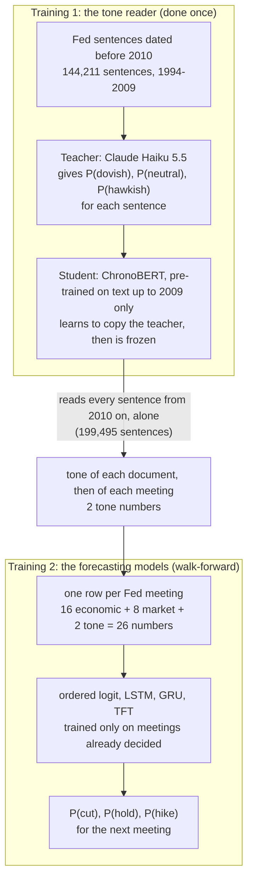

# Does the Fed's own tone help forecast its interest-rate decisions?

The Federal Open Market Committee (FOMC) is the Fed committee that sets US interest rates. It meets 8 times a year.
Before every meeting, this project forecasts one thing: **will the Fed cut, hold or hike the interest rate?** It then
asks a second question: does reading the **tone of what the Fed itself said and wrote** make that forecast better than
economic data and market prices alone?

The main result of this repository uses one tone measure (its code name in the files is **Hd**). It is tested on the
**135 Fed meetings from January 2010 to September 2026**, with four forecasting models side by side: an ordered logit
(a classic statistical model) and three neural networks, called LSTM, GRU and TFT (section 6 explains each one).

> **The result in 30 seconds.**
> Adding the Fed's tone made all four models forecast better: accuracy went up and log loss went down in every model.
> But "better on these meetings" is not yet "proven". To count as proven, a model has to pass two checks: the gain
> must be too large to be luck (p-value below 0.05), and the real tone must beat a fake tone. **No model passes both.**
> The TFT network passes the first check (p-value 0.0050) but not the second (p-value 0.082). The LSTM network passes
> the second (p-value 0.032) but not the first (p-value 0.220). In plain words: **the tone points the right way in
> every model, but 135 meetings are not enough to prove that it helps.**

## Contents

1. [The question in plain words](#1-the-question-in-plain-words)
2. [How we score and test, explained first](#2-how-we-score-and-test-explained-first)
3. [Results before and after adding the tone](#3-results-before-and-after-adding-the-tone)
4. [What data trains each model](#4-what-data-trains-each-model)
   - [4.3 Every input, one by one](#43-every-input-one-by-one)
   - [4.4 How far back each model looks](#44-how-far-back-each-model-looks)
5. [How the tone is made](#5-how-the-tone-is-made)
6. [How each model is trained](#6-how-each-model-is-trained)
7. [Why the test starts in 2010](#7-why-the-test-starts-in-2010)
8. [What we can and cannot claim](#8-what-we-can-and-cannot-claim)
9. [Checks planned next](#9-checks-planned-next)
10. [The split tone](#10-the-split-tone)
11. [Reproduce the results](#11-reproduce-the-results)
12. [Where to read more](#12-where-to-read-more)

---

## 1. The question in plain words

**The simple version.** Picture two forecasters. Both see the same economic numbers (inflation, jobs, growth) and the
same market prices (government bond yields, a stock-market fear index, the oil price). The second one also reads
everything the Fed published since its last meeting, and turns it into a number: how hawkish (leaning towards hikes)
or dovish (leaning towards cuts) the Fed sounds. If the second forecaster does better, the Fed's words carry
information that the numbers miss.

**An analogy.** You forecast a football match from team statistics and the betting odds. Should you also listen to the
coach's press conferences? Only if the coach tells you something the odds have not already priced in. Here the market
prices play the role of the betting odds. Traders read every Fed speech the day it comes out, so this is a hard test
for the tone.

**The words used in this README.** The right-hand column gives the short code names you will see in the files and in
the other documents.

| Word in this README | What it means | Numbers per meeting | Code name in the files |
|---|---|---|---|
| **economic data** | 16 economic statistics, as they were published at the time (inflation, jobs, growth, money supply and more; full list in section 4.3) | 16 | S |
| **market data** | 8 market numbers: what bond yields say about the next rate moves, the rate level, a zero-rate flag, the stock-market fear index, the oil price | 8 | M |
| **no-news model** | a model that sees only the economic and market data: the model **before** adding the tone | 24 | S+M |
| **the tone** | 2 numbers: the Fed's average tone since the last meeting, and how much it changed from the last meeting | 2 | Hd ("H" for Claude **H**aiku, which taught the reader; "d" for **d**istilled, section 5) |
| **real-tone model** | the same model with the tone added: the model **after** | 26 | S+M+Hd |
| **fake-tone model** (placebo) | the same model with the tone numbers moved to the wrong meetings, so they carry no real information | 26 | placebo-Hd |
| **ordered logit** | a classic statistical model for ordered outcomes (cut < hold < hike) | | logit |
| **LSTM network** | long short-term memory network: a neural network that reads past meetings in order and keeps a memory | | lstm |
| **GRU network** | gated recurrent unit network: a slimmer version of the LSTM network | | gru |
| **TFT network** | temporal fusion transformer: a neural network that also learns which inputs and which past meetings matter | | tft |

## 2. How we score and test, explained first

Read this section once, and every table below will make sense.

### 2.1 Accuracy: was the top pick right?

Each model gives three probabilities, for example P(cut) = 0.05, P(hold) = 0.85, P(hike) = 0.10. Its **top pick** is
the outcome with the highest probability (here: hold). **Accuracy** = the share of meetings where the top pick is what
the Fed did.

**A trap to know about.** From 2010 the Fed held at 103 of the 135 meetings (76.3%). A "model" that always says hold
is right 76.3% of the time without knowing anything. The hard and useful part is the 32 meetings where the Fed moved.

### 2.2 Log loss: how good were the probabilities?

**Simple version.** Log loss looks at the probability the model gave to what actually happened, and punishes low
probabilities hard. For one meeting it is −ln(that probability), where ln is the natural logarithm. The tables report
the average over meetings. Lower is better.

| Probability given to what happened | Log loss for that meeting |
|---|---|
| 0.99 | 0.010 |
| 0.90 | 0.105 |
| 0.50 | 0.693 |
| 1/3 (a blind three-way guess) | 1.099 |
| 0.01 | 4.605 |

**An analogy.** Two weather forecasters both say "rain" on a day it rains. One said 95%, the other 51%. Accuracy gives
both full marks. Log loss rewards the first more. And a forecaster who said 1% rain on a day it poured gets punished
very hard. That is why the project leads with log loss: someone using these forecasts cares about the probabilities,
not only the top pick.

**Rate error** is also reported: the root mean squared error (RMSE) of the forecast interest rate, in percentage
points. It turns the three probabilities into one expected rate and measures how far that was from the real rate.

### 2.3 The p-value: could the gain be luck?

**Simple version.** Suppose the tone added nothing. The two models would still score a little differently on 135
meetings, just by chance. The **p-value** is the chance of seeing a gain at least as large as ours if the tone truly
added nothing. A small p-value (below 0.05, so less than 1 in 20) means "luck is a poor explanation".

**How it is computed, step by step:**

1. For every meeting, take the no-news model's log loss minus the real-tone model's log loss. A positive number means
   the tone helped at that meeting.
2. Average these numbers over the meetings.
3. Divide the average by its standard error (how much the average would wobble by chance). This gives a t-statistic.
4. Turn the t-statistic into a one-sided p-value. It is one-sided because the question is "does the tone help?", not
   "does the tone change anything?".

The tests differ only in how they measure the wobble in step 3:

| Test | Used for | What it adds |
|---|---|---|
| **Newey-West test, 8 lags** | the three networks | neighbouring meetings are related (the Fed moves in cycles), so it does not treat them as independent; "8 lags" means it allows for links up to 8 meetings apart |
| **Clark-West test** | the ordered logit | a bigger model always pays a small price for estimating extra weights; this test adds that price back, which is fair to the bigger model |
| **Holm adjustment** | the three networks together | testing 3 networks gives 3 chances to get lucky, so the Holm adjustment raises the p-values to keep the overall risk at 5% |

### 2.4 The fake tone (placebo): is it the tone, or just two extra numbers?

**Simple version.** Adding any two numbers can make a model look better: it gets more freedom to fit, a network gets
different tuned settings, or training luck changes. So every model is also run with **fake tone**: the same numbers,
in the same range, but moved to the wrong meetings. If the fake tone helps as much as the real tone, the gain is not
from what the Fed said.

How the fake tone is made:

- **Ordered logit:** every time the model is fitted, the tone numbers are shuffled across the training meetings.
- **Networks:** the tone numbers are shifted by 130 meetings (half of all 260 meetings, about 16 years), wrapping
  around at the end. Each meeting gets the tone of a meeting about 16 years away, but the meeting-to-meeting pattern
  is kept, which matters to a model that reads meetings in order.

**An analogy.** You claim a lucky charm helps you pass exams. The test: give half the students a fake charm that looks
the same. If the fake charm helps just as much, it was never the charm.

### 2.5 The two checks every model must pass

| Check | Question | Passed when |
|---|---|---|
| **Check 1** | does the real tone beat no news? | p-value below 0.05 (Holm-adjusted for the networks) |
| **Check 2a** | does the real tone beat the fake tone? | p-value below 0.05 |
| **Check 2b** | does the fake tone fail to beat no news? | p-value 0.05 or above (if the fake tone "wins", the setup cannot be trusted) |

A model's gain counts as **proven to come from the tone** only if all three hold.

## 3. Results before and after adding the tone

All results are from January 2010 to 16 September 2026. The ordered logit is scored on all 135 meetings. The networks
are scored on the 134 scheduled meetings: the unscheduled emergency cut of 3 March 2020 is left out, as fixed before
the run. These tables are generated from the files in `results/distill/` by `scripts/make_results_tables.py`; no
number in them is typed by hand.

<!-- headline:start (generated by scripts/make_results_tables.py) -->

**Accuracy** = share of meetings where the outcome the model rated most likely is what the Fed did (higher is better). In brackets: meetings called right.

| Model | Meetings tested | No news | Fake tone | Real tone | Change from adding real tone |
|---|---|---|---|---|---|
| Ordered logit | 135 | 83.7% (113) | 83.0% (112) | 85.9% (116) | +2.2 percentage points |
| LSTM network | 134 | 76.1% (102) | 83.6% (112) | 87.3% (117) | +11.2 percentage points |
| GRU network | 134 | 76.9% (103) | 85.1% (114) | 83.6% (112) | +6.7 percentage points |
| TFT network | 134 | 88.8% (119) | 91.0% (122) | 89.6% (120) | +0.7 percentage points |

**Log loss** = the mean of −ln(probability the model gave to what actually happened) (lower is better). It judges the probabilities, not just the top pick: 0.90 on the right outcome scores 0.105, 0.50 scores 0.693, 0.01 scores 4.605.

| Model | Meetings tested | No news | Fake tone | Real tone | Change from adding real tone |
|---|---|---|---|---|---|
| Ordered logit | 135 | 0.356 | 0.335 | 0.320 | -0.036 |
| LSTM network | 134 | 0.665 | 0.621 | 0.510 | -0.155 |
| GRU network | 134 | 0.560 | 0.518 | 0.451 | -0.110 |
| TFT network | 134 | 0.403 | 0.377 | 0.318 | -0.084 |

**Rate error** = root mean squared error (RMSE) of the forecast interest rate, in percentage points (lower is better).

| Model | Meetings tested | No news | Fake tone | Real tone | Change from adding real tone |
|---|---|---|---|---|---|
| Ordered logit | 135 | 0.1287 | 0.1283 | 0.1284 | -0.0002 |
| LSTM network | 134 | 0.1531 | 0.1429 | 0.1388 | -0.0144 |
| GRU network | 134 | 0.1486 | 0.1417 | 0.1405 | -0.0081 |
| TFT network | 134 | 0.1400 | 0.1372 | 0.1352 | -0.0048 |

**The two checks.** All p-values are one-sided. Ordered logit: the Clark-West test. Networks: the Newey-West test with 8 lags on the meeting-by-meeting log-loss difference; for check 1 the p-value is Holm-adjusted over the 3 networks. A check is passed when the p-value is below 0.05.

| Model | Check 1: real tone vs no news | Check 2a: real tone vs fake tone | Check 2b: fake tone vs no news | Verdict |
|---|---|---|---|---|
| Ordered logit (Clark-West) | p-value 0.220 → not shown | not computed yet | p-value 0.105 → does not (good) | not passed: not shown to beat no news (check 2a not computed) |
| LSTM network (Newey-West) | p-value 0.220 after Holm adjustment (0.110 before) → not shown | p-value 0.032 → beats | p-value 0.370 → does not (good) | not passed: beats the fake tone, but not shown to beat no news |
| GRU network (Newey-West) | p-value 0.220 after Holm adjustment (0.167 before) → not shown | p-value 0.094 → not shown | p-value 0.380 → does not (good) | not passed: neither check 1 nor check 2a |
| TFT network (Newey-West) | p-value 0.0050 after Holm adjustment (0.0017 before) → beats | p-value 0.082 → not shown | p-value 0.237 → does not (good) | not passed: beats no news, but not shown to beat the fake tone |

<!-- headline:end -->

### 3.1 What the tables show

- **Every model improves with the real tone, on every score.** Accuracy rises, log loss falls, rate error falls.
- **The fake tone also improves every model's log loss** (ordered logit: 0.356 → 0.335). So part of the gain comes
  from adding any two numbers, not from what the Fed said.
- **The real tone has a lower log loss than the fake tone in all four models.** But that gap is large enough to pass
  check 2a only for the LSTM network.
- **The networks start much weaker than the ordered logit.** With no news, the LSTM network's log loss is 0.665
  against 0.356 for the ordered logit. The networks have thousands to hundreds of thousands of weights to learn, but
  only 48 to 259 training meetings (section 6). A weak model improves from almost any addition, which makes its gains
  harder to trust.

### 3.2 Worked example: why the TFT network's fake tone has higher accuracy than its real tone

In the accuracy table, the TFT network with fake tone gets 122 of 134 meetings right and with real tone 120. On log
loss the real tone is clearly better (0.318 against 0.377). How can both be true?

- The two versions disagree on the top pick at only 8 meetings. The fake tone is right at 5, the real tone at 3. That
  is a difference of 2 meetings.
- Three of the fake tone's 5 wins are near coin flips. On 16 December 2015 the Fed hiked: the fake tone gave
  P(hike) = 0.52, the real tone 0.44. A small difference in probability flips the whole accuracy mark.
- **One meeting decides most of it: 2 May 2018.** The Fed held. The no-news version gave P(hold) = 0.028 and the real
  tone 0.016: both expected a hike. The fake tone's scrambled numbers happened to push it to P(hold) = 0.631. That is
  luck, not information. At that one meeting the real tone's log loss is −ln(0.016) = 4.14 and the fake tone's
  −ln(0.631) = 0.46.
- That single meeting is the main reason check 2a fails for the TFT network (p-value 0.082): one big loss makes the
  average gain wobble a lot.

Accuracy only checks the top pick, so it moves in whole meetings and is easily flipped by luck. That is why log loss is
the main score.

### 3.3 Worked example: why the ordered logit fails check 1

With the real tone, the ordered logit gains 0.036 in log loss per meeting on average, but the gain swings a lot from
meeting to meeting. The two emergency meetings of March 2020 (3 and 15 March, at the start of Covid) cost the
real-tone model the most. A large spread means a large standard error, so the t-statistic is small and the Clark-West
p-value is 0.220. Leaving out those two meetings gives a p-value of 0.058. That figure was computed after seeing the
results, so it describes the result; it is not evidence.

**Not significant is not the same as "the tone does not help".** It means these 135 meetings, with only 32 rate moves,
are not enough to tell a real gain from luck.

## 4. What data trains each model

There are **two separate trainings**. The first trains the tone reader once. The second trains the forecasting models,
again and again as time moves forward.



### 4.1 Training 1: the tone reader

**The text.** Every document comes from the Fed's website. Documents shorter than 500 characters are dropped; each
document is split into sentences of 30 to 1,000 characters.

| Document type | Group used for the tone | Documents | Sentences | First | Last |
|---|---|---|---|---|---|
| Policy statements (released after each meeting) | policy | 240 | 4,176 | 25 March 1997 | 16 September 2026 |
| Press conference transcripts | policy | 94 | 36,553 | 27 April 2011 | 16 September 2026 |
| Meeting minutes (released about 3 weeks after each meeting) | minutes | 263 | 68,123 | 25 March 1994 | 7 October 2026 |
| Speeches by members of the Fed's Board | speech | 1,981 | 234,890 | 13 June 1996 | 8 October 2026 |
| **Total** | | **2,578** | **343,742** | | |

Documents released after 16 September 2026 are in the data but no forecast uses them, because no later meeting is
tested.

**How the reader is trained:**

| Item | What was used |
|---|---|
| **Labels (the teacher)** | Claude Haiku 5.5 read each sentence and gave three probabilities: dovish, neutral, hawkish. 100 of the 343,742 sentences got no usable answer. |
| **The student** | ChronoBERT, 2009 version (`manelalab/chrono-bert-v1-20091231`): a language model with about 149 million weights, pre-trained only on text written up to the end of 2009. |
| **Training data for the student** | the **144,211 sentences dated before 2010** that have a usable Haiku answer. The student learns to copy Haiku's three probabilities, not just its top label. |
| **Choosing its settings** | 6 settings were tried, training on 55,600 sentences (half of 1994-2006) and checking on 6,000 sentences (2007-2009). Chosen: learning rate 0.00002, 2 passes over the data, 16 sentences per step, at most 256 word pieces per sentence. |
| **Scoring the test period** | the frozen student reads all **199,495 sentences from 2010 on**. Haiku's own answers for these sentences are not used by any forecast in this result. They serve only to measure how well the student copies the teacher: on the 199,431 that have a Haiku answer, the student picks the same top label 83.8% of the time. |
| **Scoring the training years** | sentences from 1994-2001 are scored by a copy trained on 2002-2009, and sentences from 2002-2009 by a copy trained on 1994-2001. No model scores a sentence it was trained on. |

### 4.2 Training 2: the forecasting models

| Item | What was used |
|---|---|
| **Meetings** | 260 Fed meetings with every input, from 28 March 1995 to 16 September 2026 (scheduled and emergency meetings). One meeting = one row of numbers. |
| **What is forecast** | cut, hold or hike: the change in the Fed's target rate (the middle of the target range since December 2008). Any change larger than 0.02 percentage points counts as a move. |
| **The cutoff** | one day before the decision is announced. Every input must be dated before it. |
| **Inputs** | 26 numbers per meeting: 16 economic, 8 market and 2 tone numbers. Each one is listed in section 4.3. |
| **Scaling** | every input is turned into a z-score: its distance from the average, measured in standard deviations, using the training meetings only. This puts inflation, jobs and tone on the same scale. |

**Walk-forward: each forecast learns only from meetings already decided.**

| Forecast for | Trains on | Number of training meetings |
|---|---|---|
| 3 January 2001 (first tested meeting of the full period) | 28 March 1995 to 19 December 2000 | 48 |
| 27 January 2010 (first meeting of the main test) | 28 March 1995 to 16 December 2009 | 125 |
| 16 March 2022 | 28 March 1995 to 26 January 2022 | 223 |
| 16 September 2026 (last tested meeting) | 28 March 1995 to 29 July 2026 | 259 |

- The **ordered logit** is refitted before every meeting.
- The **networks** are refitted every 8 meetings (about once a year), because they are slow to train. In between, the
  same trained network forecasts the next meetings, and it still knows only the past.

**One honest note on the training meetings.** For 1995-2009 the tone comes from the two copies described in 4.1. Each
copy learned from Haiku's labels of nearby years, so these training rows can contain hindsight about 1995-2009. That
hindsight is only about history that was already known in 2010, so it cannot tell a model what happens at a tested
meeting. It is one reason the test starts in 2010 (section 7).

### 4.3 Every input, one by one

**Economic data (16 numbers).** Taken from ALFRED, the St. Louis Fed's archive that keeps every published version of
each statistic. Each meeting sees the numbers as they were published before its cutoff, not later revisions. The
source column gives the series name in FRED, the St. Louis Fed's database.

| # | Code name | What it is | Source series | Unit |
|---|---|---|---|---|
| 1 | `s_rate_lag` | the Fed's target rate before the meeting | DFEDTAR; middle of DFEDTARL and DFEDTARU since 2008 | % |
| 2 | `s_m2_mom` | money supply (M2), change from the previous month | M2SL | % |
| 3 | `s_m2_yoy` | money supply (M2), change from 12 months earlier | M2SL | % |
| 4 | `s_pce_yoy` | inflation of personal consumption prices (PCE); the Fed's 2% target is set on this | PCEPI | % a year |
| 5 | `s_pce_core_yoy` | core PCE inflation: the same without food and energy | PCEPILFE | % a year |
| 6 | `s_payems_chg` | change in the number of jobs outside farming in the latest month | PAYEMS | thousands of jobs |
| 7 | `s_earn_yoy` | weekly earnings of production and non-supervisory workers, change from a year earlier | CES0500000030 | % a year |
| 8 | `s_gdp_yoy` | the size of the economy (nominal gross domestic product), change from 4 quarters earlier | GDP | % a year |
| 9 | `s_u6_mom` | broad unemployment rate (U-6, which also counts involuntary part-timers), change from the previous month | U6RATE | percentage points |
| 10 | `s_u6_yoy` | broad unemployment rate (U-6), change from 12 months earlier | U6RATE | percentage points |
| 11 | `s_ppi_yoy` | inflation of producer prices (PPI) | PPIACO | % a year |
| 12 | `s_cpi_yoy` | inflation of consumer prices (CPI) | CPIAUCSL | % a year |
| 13 | `s_cpi_core_yoy` | core consumer price inflation: without food and energy | CPILFESL | % a year |
| 14 | `s_hpi_yoy` | house prices, change from a year earlier | HPIPONM226S | % a year |
| 15 | `s_slope_10y2y` | 10-year minus 2-year government bond yield | DGS10 − DGS2 | percentage points |
| 16 | `s_slope_1y6m` | 1-year minus 6-month government bond yield | DGS1 − DGS6MO | percentage points |

**Market data (8 numbers).** The last value before the cutoff, from FRED. The first four are "spreads": a bond yield
minus the Fed's current rate. A positive spread means the market expects hikes within that time.

| # | Code name | What it is | Source series | Unit |
|---|---|---|---|---|
| 17 | `m_sp_tbill_3m` | 3-month government bill yield minus the target rate | DTB3 | percentage points |
| 18 | `m_sp_y6m` | 6-month yield minus the target rate | DGS6MO | percentage points |
| 19 | `m_sp_y1` | 1-year yield minus the target rate | DGS1 | percentage points |
| 20 | `m_sp_y2` | 2-year yield minus the target rate | DGS2 | percentage points |
| 21 | `m_target_level` | the target rate at the cutoff (always equal to input 1) | as input 1 | % |
| 22 | `m_zero_bound` | 1 if the target rate is at most 0.30%, else 0 (at zero the Fed cannot cut) | from input 21 | 0 or 1 |
| 23 | `m_vix` | the stock market's expected volatility over the next 30 days (the VIX "fear index") | VIXCLS | index points |
| 24 | `m_wti` | the price of US crude oil (West Texas Intermediate) | DCOILWTICO | dollars a barrel |

**When the market data are taken: before the meeting even starts.** A Fed meeting lasts two days, and the decision is
announced on the second day. The cutoff is one day before the announcement, so it falls on the first day of the
meeting. Each market number is the last value dated **strictly before** the cutoff (the code keeps only earlier dates:
`asof` in `src/fed_news/download/fred_market.py`). Example for the decision of 16 March 2022:

| Date | What happened |
|---|---|
| 14 March 2022 | the last market values the model sees |
| 15 March 2022 | the cutoff: day 1 of the meeting |
| 16 March 2022 | the decision is announced: day 2 of the meeting |

So the market data are two days older than the announcement. The economic data follow the same rule: only versions
published before the cutoff. The market numbers do already contain the market's **expectation** of this meeting's
decision (a 3-month bill yield already prices in a likely hike). That is allowed, because it was known before the
announcement, and it is the reason the market data are so strong and the tone finds it hard to add anything.

**Tone (2 numbers).** Made by the distilled reader (section 5).

| # | Code name | What it is | Unit |
|---|---|---|---|
| 25 | `n_stance` | the Fed's average tone in the documents released since the previous meeting's cutoff | from −1 (fully dovish) to +1 (fully hawkish) |
| 26 | `n_stance_chg` | this meeting's tone minus the previous meeting's tone | same |

The value of every input on 16 March 2022, and why each matters to the Fed: [docs/2](docs/2_economy_and_market_inputs.md).

### 4.4 How far back each model looks

**The simple version.** The **look-back** is how many recent meetings a model reads when it makes one forecast. It is
not the same as the training data. The training data are all past meetings the model learned from (125 to 259 for the
main test). The look-back is how many of the most recent meetings it reads at the moment of forecasting.

**An analogy.** A doctor has studied thousands of past patients: that is the training. For today's patient, the doctor
reads the last few check-ups: that is the look-back.

- **The ordered logit reads 1 meeting**: the row of 26 numbers for the meeting it forecasts. Some of its inputs still
  carry history inside them: the yearly changes compare with 12 months earlier, the monthly changes with the previous
  month, the tone covers all Fed text since the previous meeting (about 6 weeks), and the tone change compares with
  the previous meeting.
- **The networks read the last L meetings**, in time order, each as the same row of 26 numbers. L is chosen by tuning
  from 2, 4, 8 or 12 meetings, again at the start of 2001, 2005, 2009, 2013, 2017, 2021 and 2025. Because each row's
  tone covers the text since the meeting before it, a look-back of 4 meetings means the network sees roughly the last
  6 months of Fed text.

<!-- lookback:start (generated by scripts/make_results_tables.py) -->

**How many meetings each model reads for one forecast.** Each cell is the look-back chosen by tuning at the start of that period and used for every forecast in it. For example, the TFT network with real tone, forecasting a meeting in 2022, uses the value tuned at the start of 2021.

| Model | Version | 2001-2004 | 2005-2008 | 2009-2012 | 2013-2016 | 2017-2020 | 2021-2024 | 2025-2026 |
|---|---|---|---|---|---|---|---|---|
| Ordered logit | every version | 1 | 1 | 1 | 1 | 1 | 1 | 1 |
| LSTM network | No news | 2 | 4 | 4 | 2 | 2 | 2 | 4 |
| LSTM network | Real tone | 4 | 4 | 4 | 2 | 2 | 2 | 4 |
| LSTM network | Fake tone | 4 | 4 | 2 | 2 | 2 | 2 | 4 |
| GRU network | No news | 4 | 4 | 4 | 4 | 8 | 2 | 2 |
| GRU network | Real tone | 4 | 4 | 4 | 4 | 2 | 4 | 2 |
| GRU network | Fake tone | 4 | 4 | 4 | 4 | 2 | 4 | 8 |
| TFT network | No news | 8 | 8 | 8 | 2 | 2 | 4 | 2 |
| TFT network | Real tone | 8 | 2 | 4 | 4 | 2 | 8 | 2 |
| TFT network | Fake tone | 8 | 2 | 8 | 2 | 4 | 4 | 2 |

**What each look-back means in time.**

| Look-back (meetings) | Meetings in the window | Time from the oldest meeting in the window to the forecast meeting, from 2010 (middle value; shortest to longest) | Chosen in how many of the 63 network cells above |
|---|---|---|---|
| 1 (ordered logit) | the forecast meeting only | 0 days | always, by design |
| 2 | the forecast meeting and the one before | 43 days, about 6 weeks (12 to 56 days) | 25 |
| 4 | the forecast meeting and the 3 before | 136 days, about 4.5 months (91 to 148 days) | 29 |
| 8 | the forecast meeting and the 7 before | 322 days, about 10.6 months (266 to 330 days) | 9 |
| 12 | the forecast meeting and the 11 before | 504 days, about 16.6 months (448 to 512 days) | 0 |

<!-- lookback:end -->

**How to read these tables.** For the main test (from 2010) the columns from 2009-2012 onwards apply. The networks
mostly chose 2 or 4 meetings (about 6 weeks to 4.5 months). A look-back of 12 meetings was never chosen. The chosen
value jumps between periods (the TFT network with real tone goes 4, 4, 2, 8, 2) because there are so few meetings
that tuning is unstable.

**Who chooses the look-back?** Not the network itself while it learns, and not us by hand. The automatic search
(the Optuna library) chooses it **before** the network is trained, together with the other settings:

1. We fix the choices: 2, 4, 8 or 12 meetings (`run_networks.py` in `src/fed_news/studies/networks/`). The search can
   only pick from these four.
2. At each tuning point, the search proposes one complete setting: look-back, memory size, dropout, learning rate,
   weight decay, batch size, and the number of layers (or attention heads for the TFT network).
3. The network is trained with that setting on meetings before the tuning point only, and scored by log loss on 4
   time-ordered splits.
4. This is repeated 20 times. Each new proposal is made near the settings that scored well so far.
5. The setting with the lowest average log loss wins, and its look-back is used for every forecast until the next
   tuning point.

*Analogy: a cook tries 20 recipes on last year's customers, then uses the best one for the whole of next year.*
Because the look-back is chosen together with all the other settings, from only 20 tries and few meetings, the chosen
value is partly luck. That is why it jumps between periods.

### 4.5 Worked example: what the forecast for 16 March 2022 knew

The cutoff was 15 March 2022. At that moment the model knew:

| Input | Latest value it could see |
|---|---|
| consumer prices (CPI) and core CPI | February 2022 (released 10 March) |
| jobs, broad unemployment, earnings | February 2022 |
| consumption prices (PCE) and core PCE | January 2022 (February was not out yet) |
| market prices | 14 March 2022 |
| Fed text | documents released 25 January to 14 March 2022 |
| the tone | −0.0005 and +0.0208 (worked out in section 5) |

- The ordered logit was trained on 223 meetings (1995 to January 2022) and read one row of 26 numbers for March 2022.
- The TFT network with real tone read the last 8 meetings as a table of 8 rows × 26 numbers (28 April 2021 to
  16 March 2022), because tuning at the start of 2021 had chosen a look-back of 8.
- Inflation was far above target and hiring was strong. The Fed hiked.

## 5. How the tone is made

**The simple version.** Score every sentence, average the sentences into a document, average the documents into a
meeting.

1. **Sentence:** the reader gives P(dovish), P(neutral), P(hawkish). Tone = P(hawkish) − P(dovish), a number between
   −1 and +1.
2. **Document:** the average tone of its sentences.
3. **Meeting window:** every document released between the previous meeting's cutoff and this meeting's cutoff.
4. **Meeting tone (`n_stance`):** first the average tone within each group (policy statements and press conferences,
   minutes, speeches), then the average of the groups. This gives each group equal weight, so the many speeches do not
   drown out the single statement.
5. **Tone change (`n_stance_chg`):** this meeting's tone minus the previous meeting's.

**Worked example: 16 March 2022** (window 25 January to 14 March 2022)

| Released | Document | Group | Document tone |
|---|---|---|---|
| 26 January 2022 | policy statement | policy | −0.0285 |
| 26 January 2022 | press conference | policy | +0.0188 |
| 16 February 2022 | minutes of the January meeting | minutes | −0.0440 |
| 18 February 2022 | speech | speech | −0.0714 |
| 21 February 2022 | speech | speech | +0.0999 |
| 24 February 2022 | speech | speech | +0.1133 |

- Group averages: policy (−0.0285 + 0.0188) ÷ 2 = −0.0048; minutes −0.0440; speech
  (−0.0714 + 0.0999 + 0.1133) ÷ 3 = +0.0473.
- Meeting tone = (−0.0048 − 0.0440 + 0.0473) ÷ 3 = **−0.0005**.
- The January meeting's tone was −0.0213, so the tone change = −0.0005 − (−0.0213) = **+0.0208**.
- **The two tone numbers for this meeting are −0.0005 and +0.0208.**

**Why are the numbers so small?** Most Fed sentences are neutral, and hawkish and dovish sentences cancel out. Typical
values lie between −0.05 and +0.05. What matters is "above or below normal", which the z-score takes care of.

Full detail, including how one sentence becomes three probabilities: [docs/3](docs/3_from_text_to_tone.md).

## 6. How each model is trained

All four models end the same way: one score per meeting and two cut points, which turn the score into ordered
probabilities for cut < hold < hike. They differ in what they read and how many weights they learn.

**The simple version of each model:**

- **Ordered logit.** Multiply each input by a weight and add them up into one "pressure to hike" score. Two cut points
  split the score line into cut | hold | hike. *Analogy: a thermometer with two marks; below the first mark the Fed
  cuts, above the second it hikes.*
- **LSTM network** (long short-term memory). Reads the last few meetings in order and carries a memory along. At each
  meeting, gates decide what to forget, what to take in and what to pass on. *Analogy: re-reading the last few pages
  of a diary before guessing what happens next.*
- **GRU network** (gated recurrent unit). A slimmer LSTM network with two gates instead of three, so about 25% fewer
  weights.
- **TFT network** (temporal fusion transformer, a compact version). First learns which inputs matter at this meeting,
  then reads the meetings with an LSTM layer, then lets the latest meeting look back at the earlier ones and weigh the
  relevant ones (this step is called attention).

**Side by side:**

| | Ordered logit | LSTM network | GRU network | TFT network |
|---|---|---|---|---|
| **Reads per forecast** | 1 row of 26 numbers (this meeting) | the last L meetings: L rows of 26 numbers | the same | the same |
| **Look-back L** | 1 | tuned: 2, 4, 8 or 12 meetings (section 4.4) | the same | the same |
| **Weights to learn** | 28 (26 weights + 2 cut points) | from 5,010 (memory size 16, 2 layers) up to 817,410 (memory size 256, 2 layers) | up to 159,106 (memory size 128, 2 layers) | for example 9,240 (memory size 8, 1 attention head) |
| **How it learns** | lowest log loss, plus a penalty that pulls the weights towards 0 so they do not overfit | lowest log loss in an ordered form (the CORAL loss), with weight decay and dropout against overfitting | the same | the same |
| **How its settings are chosen** | the penalty strength is chosen from 6 values every time it is fitted, by testing on 5 time-ordered splits of the training meetings | 20 tries of an automatic search (the Optuna library) at 7 points (the start of 2001, 2005, 2009, 2013, 2017, 2021, 2025); each try is scored on 4 time-ordered splits, and training stops early when the score stops improving | the same | the same |
| **Refitted** | before every meeting | every 8 meetings | the same | the same |
| **Randomness** | none (same answer every run) | trained 8 times from different random starting weights; the 8 sets of probabilities are averaged | the same | the same |

Two rules hold for every model:

- **Splits are always in time order.** A model is never trained on later meetings and checked on earlier ones, because
  a real forecaster never could.
- **The fake-tone versions are tuned separately**, with their own 20 tries, so they get the same chance as the real
  tone.

The tuned setting of every network at every tuning point: [docs/HYPERPARAMETERS.md](docs/HYPERPARAMETERS.md). The
models with their equations and a full worked example of the ordered logit: [docs/5](docs/5_models.md).

## 7. Why the test starts in 2010

**The problem.** Claude Haiku 5.5 was trained on text up to 2026. It may "remember" what the Fed did after a speech.
If Haiku scored a 2015 sentence, it might call it hawkish partly because it remembers the December 2015 hike. That is
**look-ahead**: information no forecaster had at the time.

**What the design does about it:**

- Haiku only labels sentences **dated before 2010**, and those labels are used only to train the student.
- The student, ChronoBERT, was pre-trained only on text up to the end of 2009.
- From 2010 on, the frozen student reads every sentence **alone**. It never sees a Haiku label from 2010 on.
- So whatever Haiku remembers can only reach the student's training labels, which are all dated before the test
  period.

**An analogy.** A student practises on old exam papers marked by a teacher who already knows the answers. The marks
may contain hindsight, but only about the old exams. Then the student sits a new exam alone, with no teacher in the
room. The student's score on the new exam cannot come from the teacher's memory of it.

**What stays imperfect:**

- **Before 2010 the tone leaks.** The tone for 1995-2009 comes from copies trained on Haiku's labels of nearby years,
  so results for 2001-2009 are not clean. That is why the main result uses 2010 onwards only.
- **The archive of published versions has a gap before 2011-2012.** For some statistics (earnings, broad unemployment,
  house prices) no earlier versions were archived, so the first archived version is used. This affects the no-news and
  the tone models equally, so it cannot by itself create a gain for the tone.

## 8. What we can and cannot claim

**What can be said:**

> "From 2010 to 2026 (135 Fed meetings), adding the Fed's tone, read by a ChronoBERT model distilled from Claude Haiku
> and frozen at the end of 2009, raised accuracy and lowered log loss in all four forecasting models. The gain is not
> proven: no model both beat the no-news model with a p-value below 0.05 and beat a fake tone with a p-value below
> 0.05."

**What cannot be said yet:**

- "Fed tone improves interest-rate forecasts", without conditions. The tests do not show it.
- "The TFT network result is significant, so the tone works." The TFT network beats no news (Holm-adjusted p-value
  0.0050) but not its own fake tone (p-value 0.082), so its gain is not shown to come from the tone's content.

**Things a reader should know:**

1. **This is attempt 12 of 14.** The project tried 14 designs (all listed in [results/ATTEMPTS.md](results/ATTEMPTS.md)).
   This tone's own tests were fixed before its run, in
   [docs/studies/3_sigtests_distill/](docs/studies/3_sigtests_distill/2026-10-21-tests-and-distill-design.md). Its
   main pre-registered test was the ordered logit (Clark-West p-value 0.220, not supported).
2. **This tone became the repository's headline after every result was known** (decided on 1 November 2026). Before
   that, the repository led with the split tone (section 10).
3. **Few informative meetings.** From 2010 the Fed moved only 32 times, and 64 of the 135 meetings were at a zero
   rate, where a cut is impossible.
4. **Network p-values ignore training randomness.** Results move with the random starting weights and the tuned
   settings, and the Newey-West test only counts variation across meetings.
5. **One input is duplicated.** Inputs 1 and 21 (the target rate before the meeting) are equal at every meeting, so
   there are 23 distinct inputs, not 24. This does not change any forecast.

## 9. Checks planned next

None of these has been run. Each would be written down and fixed before it runs.

| Check | Why | Cost |
|---|---|---|
| **Many fake tones** | One fake tone is one random draw and can get lucky, as on 2 May 2018. Run 20 fake tones with 20 different shifts, fixed in advance (shifts under 2 years excluded, because tone changes slowly). If the real tone beats all 20, the p-value is 1/21 = 0.048. | ordered logit: under an hour on an ordinary processor; networks: about 2 hours on the graphics card per fake tone |
| **Real tone against fake tone for the ordered logit** | check 2a is not computed yet for the ordered logit | about 5 minutes |
| **Taylor-rule baseline** (attempt 13) | published studies often compare against a Taylor rule (the previous rate, inflation and unemployment) instead of market prices. It asks "does the tone add to basic economic data?", an easier and different question. Designed in [docs/studies/4_text_vs_economy/](docs/studies/4_text_vs_economy/2026-10-21-text-vs-economy-design.md), not built. | ordered logit, about 5 minutes once built |
| **New meetings** | every Fed decision after 16 September 2026 is a true out-of-sample test with the code frozen as it is | free, but slow |

## 10. The split tone

The repository was first built for **attempt 14** (code name Hs, "s" for split). It keeps the tone split by document
type: 6 numbers instead of 2 (the tone of policy statements and press conferences, of minutes and of speeches, and the
change of each). It comes from the same distilled reader, so the same leak argument (section 7) applies.

- **Ordered logit:** the split tone beat no news from 2010 (one-sided Clark-West p-value 0.0100), and its fake tone did
  not (p-value 0.456). That passed its own rule, fixed before the run. It is worded as exploratory, because it was the
  14th attempt.
- **Split against single tone:** the 6 numbers did not forecast measurably better than the 2 numbers of the single
  tone (Clark-West p-value 0.071).
- **Networks:** not significant after the Holm adjustment (LSTM network 0.297, GRU network 0.372, TFT network 0.408).

All tables for both tones: [docs/7_results.md](docs/7_results.md).

## 11. Reproduce the results

Needs Python 3.13 and [uv](https://docs.astral.sh/uv/) (or pip with the versions pinned in `pyproject.toml`).

```bash
git clone https://github.com/taminggg1-cmyk/distilled-tone-split-doctype
cd distilled-tone-split-doctype
uv sync                                               # exact package versions from uv.lock
uv run python scripts/download_data.py                # 2 zip files, about 120 MB, checksums verified
uv run python -m fed_news.studies.distill.run_logit   # single tone, ordered logit, about 5 minutes
uv run python -m fed_news.studies.doctype.run_logit   # split tone, ordered logit, about 5 minutes
uv run python -m fed_news.studies.doctype.run_networks forecast --device cpu   # networks from the saved forecasts
uv run python scripts/make_results_tables.py          # rewrites the tables in this README and in docs/ from results/
git status                                            # no changed file = reproduced
uv run python -m pytest                               # unit tests, about 2 minutes
```

What needs more than an ordinary processor:

- **Network tuning and training** (`run_networks tune`): an NVIDIA graphics card (CUDA) and hours. Retraining on a
  different graphics card does not give bit-identical numbers, so the results use the saved forecasts of each random
  start; `forecast` reuses them when the settings and data fingerprints match.
- **The distilled reader** (`chronobert_distill tune|final|tone`): an NVIDIA graphics card, about 3-4 hours on an
  RTX 2060.
- **The teacher** (`coral.haiku_ordinal`): Anthropic's paid service. Never needed: its output is in the data release.

## 12. Where to read more

| Chapter | What it explains |
|---|---|
| [1. The question and timing](docs/1_question_and_timing.md) | what is forecast, the cutoff, the archive of published versions |
| [2. Economy and market inputs](docs/2_economy_and_market_inputs.md) | each of the 24 economic and market inputs, its source, its value on 16 March 2022, the z-score |
| [3. From Fed text to tone](docs/3_from_text_to_tone.md) | the teacher, the distilled reader, sentence to meeting, single and split tone |
| [4. What each forecast sees](docs/4_what_each_forecast_sees.md) | look-back, training meetings, walk-forward |
| [5. The models](docs/5_models.md) | ordered logit with a full worked example; LSTM, GRU and TFT networks with equations and shapes |
| [6. Tests and controls](docs/6_tests_and_controls.md) | log loss, Clark-West, Newey-West, Holm, fake tone and shuffled-outcome controls |
| [7. Results](docs/7_results.md) | every result table for both tones, generated from `results/` |
| [8. Limits](docs/8_limits.md) | what can and cannot be said |
| [Code map](docs/CODE_MAP.md) | every step, its file, its function and its output |
| [Data](docs/DATA.md) | every data file, its columns and checksum |
| [Glossary](docs/GLOSSARY.md) | every code name and symbol |
| [Network settings](docs/HYPERPARAMETERS.md) | the tuned setting of every network at every tuning point |
| [Attempt history](results/ATTEMPTS.md) | all 14 attempts and their results |

**Where the files are:**

```
results/distill/                the single tone: the main result (ordered logit and networks), reader tuning and fidelity
results/doctype/                the split tone (attempt 14 and 14b)
results/coral/                  the no-news forecasts that every comparison shares; no tests live here
src/fed_news/studies/distill/   the distilled reader (chronobert_distill.py) and the single-tone runs
src/fed_news/studies/doctype/   the split tone
src/fed_news/...                the shared code (see docs/CODE_MAP.md)
docs/studies/                   the design documents, each committed before its results
scripts/                        download_data.py, make_results_tables.py
tests/                          unit tests
```

## Licence

MIT (see [LICENSE](LICENSE)). The data have their own sources and terms; see [docs/DATA.md](docs/DATA.md).
