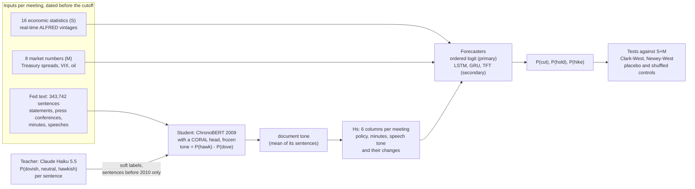

# Distilled Fed tone, split by document type: forecasting FOMC decisions

Before each FOMC meeting: **will the Fed cut, hold or hike?** This repository tests whether the tone of the Fed's own
words helps answer that, when the tone is read sentence by sentence by a language model and **kept split by the kind of
document it came from**: policy statements and press conferences, minutes, and speeches.

This is **attempt 14** (with its network part, **14b**) of a longer project. All 14 attempts are listed, with their
results, in [`results/ATTEMPTS.md`](results/ATTEMPTS.md). The code and results here are copied unchanged from commit
`c35052f` of [fed-news-forecasting-final](https://github.com/taminggg1-cmyk/fed-news-forecasting-final) (branch
`coral`), so that attempt 14 can be read and rerun on its own.

## The result in plain words

**Ordered logit (attempt 14, the primary test, fixed before the run).** Adding the six split tone columns to the 24
economic and market inputs improved the forecasts of the **135 FOMC decisions from 2010 to September 2026**:

| | S+M (no tone) | S+M+Hs (split tone) |
|---|---|---|
| log loss (lower is better) | 0.356 | 0.322 |
| accuracy | 83.7% | 85.9% |
| RMSE of the forecast rate (percentage points) | 0.129 | 0.126 |
| one-sided Clark-West p, against S+M | | **0.0100** |
| the same test with placebo tone (fake tone, wrong timing) | | 0.456 |
| the same test with shuffled outcomes | | 0.933 |

The placebo and shuffled controls do not pass, so the result is not void, and the pre-registered decision is
**"supported"**. It is worded as **exploratory** because it is the 14th attempt, designed after the earlier results
were known; a correction for all the attempts would not leave it significant.

**Networks (attempt 14b, a declared secondary test).** LSTM, GRU and TFT with the same split tone: **not
significant** (Newey-West p from 2010 after Holm over the 3 networks: LSTM 0.297, GRU 0.372, TFT 0.408). The networks
are much weaker than the ordered logit to begin with (too many parameters for 48-250 training meetings).

**Split vs single tone.** The six split columns did not forecast measurably better than a single averaged tone (two
columns, attempt 12): Clark-West p = 0.071, DM-HLN p = 0.544. What the split changed is that the gain became steadier
from meeting to meeting.

Full tables: [docs/7_results.md](docs/7_results.md). What can and cannot be claimed: [docs/8_limits.md](docs/8_limits.md).

## How it works, in one picture



## The three questions this repository answers first

**1. What does each model look like, what does it read, and what does each forecast see?**
The ordered logit sees **one row of 30 numbers** for the meeting it forecasts (16 S + 8 M + 6 tone), standardised with
the training rows only, and is refit at every meeting on all earlier meetings (48 meetings for the first test meeting
in 2001, 223 for March 2022). The networks see **the last L meetings** as a `[L × 30]` tensor (L tuned from
{2, 4, 8, 12}; 2, 4 or 8 were chosen), pass it through an LSTM, GRU or TFT, keep the last step, and output three
ordered probabilities through a CORAL head; they are refit every 8 meetings and averaged over 8 seeds. No model ever
sees the text itself. → [docs/4](docs/4_what_each_forecast_sees.md), [docs/5](docs/5_models.md)

**2. How is each sentence scored, and how do sentence scores become the model's inputs?**
Each sentence gets three probabilities (dovish, neutral, hawkish) from the distilled ChronoBERT, and its tone is
P(hawkish) − P(dovish). From there it is averaging all the way up: sentences → document tone (mean) → for each meeting, the
mean document tone of each group (policy, minutes, speech) released in the window since the previous meeting → three
levels plus their changes from the previous meeting = **6 columns**. Worked example for 16 March 2022: policy −0.0048,
minutes −0.0440, speech +0.0473. → [docs/3](docs/3_from_text_to_tone.md)

**3. What are the dimensions of every input?**

| Object | Shape |
|---|---|
| a batch of sentences into the reader | tokens `[B, T]` → ChronoBERT `[B, T, 768]` → mean over tokens `[B, 768]` → CORAL `[B, 2]` → classes `[B, 3]` → tone `[B]` |
| one meeting, no tone (S+M) | 24 numbers |
| one meeting, single tone (S+M+Hd) | 26 numbers |
| one meeting, split tone (S+M+Hs) | **30 numbers** |
| ordered logit input | `[30]`; 30 coefficients + 2 cut points |
| network input | `[B, L, 30]` → hidden `[B, L, H]` → last step `[B, H]` → CORAL `[B, 2]` → `[B, 3]` |

→ [docs/3.5](docs/3_from_text_to_tone.md#35-the-tensor-shapes-inside-the-reader),
[docs/5](docs/5_models.md#53-lstm-memory-with-gates)

## Read the explanation in order

| Chapter | What it explains |
|---|---|
| [1. The question and timing](docs/1_question_and_timing.md) | what is forecast, the cutoff, real-time data, what the model may know |
| [2. Economy and market inputs](docs/2_economy_and_market_inputs.md) | each of the 24 S and M inputs, its source, its value on 16 March 2022, the z-score |
| [3. From Fed text to tone](docs/3_from_text_to_tone.md) | the CORAL head, the Haiku teacher, the distilled ChronoBERT, sentence → document → meeting, Hd and Hs |
| [4. What each forecast sees](docs/4_what_each_forecast_sees.md) | input window vs training data, lookbacks, walk-forward |
| [5. The models](docs/5_models.md) | ordered logit with a full worked example; LSTM, GRU, TFT with equations and shapes; tuning |
| [6. Tests and controls](docs/6_tests_and_controls.md) | log loss, Clark-West (with a worked meeting), Newey-West, Holm, placebo and shuffled controls, decision rules |
| [7. Results](docs/7_results.md) | every result table, generated from `results/`, and how to read it |
| [8. Limits](docs/8_limits.md) | what can and cannot be said |
| [Code map](docs/CODE_MAP.md) | every step → file → function → output, and the commands |
| [Data](docs/DATA.md) | every data file, its columns and checksum |
| [Glossary](docs/GLOSSARY.md) | every abbreviation and symbol |
| [Network settings](docs/HYPERPARAMETERS.md) | the tuned setting of every network at every tuning point |
| [Attempt history](results/ATTEMPTS.md) | all 14 attempts and their results |

## Where things are

```
src/fed_news/studies/doctype/   attempt 14: the split tone (group_tone.py), the ordered logit (run_logit.py),
                                the networks (run_networks.py)                                  <- start here
src/fed_news/studies/distill/   attempt 12: the distilled reader (chronobert_distill.py) and the single-tone arm
src/fed_news/...                the shared code attempt 14 builds on (see docs/CODE_MAP.md)
results/doctype/                attempt 14 and 14b results
results/distill/                attempt 12 results (the single-tone comparison arm, reader tuning and fidelity)
results/coral/                  the shared S+M baseline forecasts
docs/                           the explanation (chapters 1-8) and reference pages
docs/studies/                   the design documents, each committed before its results (attempt 14: 5_doctype/)
scripts/                        download_data.py, make_results_tables.py
tests/                          unit tests (attempt 14: tests/studies/doctype/)
```

## Reproduce the results

Needs Python 3.13 and [uv](https://docs.astral.sh/uv/) (or pip with the versions pinned in `pyproject.toml`).

```bash
git clone https://github.com/taminggg1-cmyk/distilled-tone-split-doctype
cd distilled-tone-split-doctype
uv sync                                               # exact package versions from uv.lock
uv run python scripts/download_data.py                # 2 zips, about 120 MB, checksums verified
uv run python -m fed_news.studies.distill.run_logit   # the single-tone arm, about 5 minutes
uv run python -m fed_news.studies.doctype.run_logit   # attempt 14, about 5 minutes
uv run python -m fed_news.studies.doctype.run_networks forecast --device cpu   # 14b from the saved seed forecasts
git status                                            # no changed file in results/ = reproduced
uv run python -m pytest                               # unit tests, about 2 minutes
```

Rerunning these on the released data rewrites every file in `results/doctype/` and `results/distill/` with the same
content (checked on 2026-10-31: all 176 result files identical, apart from Windows line endings, which git
normalises).

What needs more than a CPU:

- **Network tuning and training** (`run_networks tune`): a CUDA GPU and hours. Retraining on a different GPU is not
  bit-identical, so the saved seed forecasts are what the results use; `forecast` reuses them when the settings and
  data fingerprints match.
- **The distilled reader** (`chronobert_distill tune|final|tone`): a CUDA GPU, about 3-4 hours on an RTX 2060.
- **The teacher** (`coral.haiku_ordinal`): Anthropic's paid API. Never needed: its output is in the data release.

## Licence

MIT (see [LICENSE](LICENSE)). The data have their own sources and terms; see [docs/DATA.md](docs/DATA.md).
